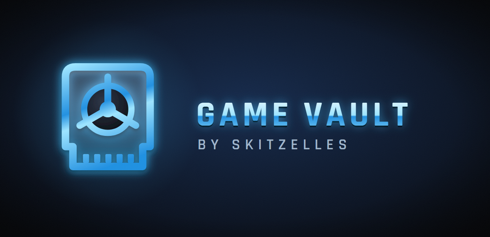

  

  <b>Game Vault: plug in a USB stick, pick a game, play.</b> 
  An all-in-one game library for Xbox Series X|S in Dev Mode, made for the TV and the controller. 
  <b>Early software: expect rough edges, and tell us about them.</b>

  
  
  
  
  
  

  <a href="https://github.com/skitzellez/xbox-game-vault/releases"><b>⬇️ Download</b></a> &nbsp;•&nbsp;
  <a href="#-installation"><b>🚀 Install</b></a> &nbsp;•&nbsp;
  <a href="#-reporting-a-problem"><b>🐞 Report a problem</b></a> &nbsp;•&nbsp;
  <a href="https://www.patreon.com/Skitzelles"><b>❤️ Support</b></a>

---

Game Vault finds the games on your USB stick, names them, fetches the box art and starts each one in the
emulator that suits it. There are no folders to set up and no settings files to edit. It comes with its own
port of the original Xbox emulator **xemu**, and it sets up the other emulators for you.

> [!WARNING]
> **Game Vault is young.** Many games play well, some don't yet, and things change quickly. If something goes
> wrong, a short report with the log helps a lot (see [Reporting a problem](#-reporting-a-problem)).

> [!IMPORTANT]
> **No games, Microsoft BIOS files or keys are included, and none ever will be.** Use dumps of games and
> consoles you own. The only BIOS files that come along are free, open-source ones.

## ✨ Features

| | |
|---|---|
| 🔌 **Plug and play** | Put your games on a USB stick in any folders, with any names. FAT32, exFAT and NTFS all work as they are, with no formatting or permissions to set. |
| 🔎 **Knows every game** | Reads the files themselves, so a PlayStation 2 game is never mistaken for a PlayStation one. Zipped and packed games (ZIP, 7z, RAR, CHD) work too. |
| 🖼️ **Box art and names** | Filled in by themselves. |
| 🎨 **A look for every console** | Each console has its own colour and moving background; a console with only a few games shows the chosen one big. |
| 🟢 **Original Xbox** | Our own Dev Mode port of xemu. A free BIOS is built in, so games start even without Xbox files of your own. |
| ⚪ **Xbox 360** (Series X\|S) | Our build of Xenia Canary plays 360 games from any USB drive, with no permission step and no profile to make. |
| 📀 **Discs from the drive** | Your own PlayStation and PlayStation 2 discs play straight from the Series X disc drive - no PC needed. Original Xbox discs cannot be read by the Series X drive: copy them to your USB drive once. |
| 💾 **Saves on your stick** | Saves, memory cards, save states and BIOS files live in a `Game Vault` folder on the USB drive, right next to your games. |
| 🛟 **Silent backup** | The console keeps a copy of your saves. Lose the stick, plug in a new one, and they come back by themselves. |
| ⚡ **Big collections** | Thousands of games load in seconds once they have been seen. |
| 🧰 **One setup program** | Run it once on a Windows PC or a Mac and it installs everything on the console. |

## 🕹️ Supported systems

| System | Plays in |
|---|---|
| Original Xbox | xemu for Dev Mode (ours) |
| Xbox 360 (Series X\|S) | Xenia for Game Vault (ours, based on Xenia Canary) |
| PlayStation, Saturn, Sega CD, Game Boy / Color / Advance, NES, SNES, N64, DS, Genesis and other cartridge and CD systems, ScummVM | RetroArch for Game Vault (ours, based on RetroArch) |
| PlayStation 2 | XBSX2 for Game Vault (ours, based on XBSX2) |
| GameCube, Wii | Dolphin for UWP |
| PSP | PPSSPP |
| Dreamcast | Flycast |

## 🎮 Supported consoles

| Console | Status | Notes |
|---|---|---|
| **Xbox Series X** | Recommended | Where Game Vault is built and tested. |
| Xbox Series S | Should work | Less memory and a slower GPU; not tested yet. |
| Xbox One family | Not recommended | Untested; likely too slow for the newer systems. |

All of them need **Developer Mode**. Game Vault does not run in retail mode.

## 📋 Requirements

- An Xbox in **Developer Mode**. This needs a Microsoft Partner Center developer account, which has a one-time
  fee. Microsoft's guide: [Xbox Developer Mode activation](https://learn.microsoft.com/windows/uwp/xbox-apps/devkit-activation).
- A Windows PC or a Mac on the same network, for the one-time setup.
- A USB drive with your games.
- Optional: BIOS files from your own consoles, for the systems that need them (PlayStation 2, Sega CD and a few
  others). Put them in the `Game Vault\bios` folder on the USB drive.

## 🚀 Installation

1. On the console, open **Dev Home** and turn on the **Device Portal** with a user name and password (Remote
   Access Settings). Make sure a profile is signed in.
2. Download **GameVault-Setup.zip** from [Releases](https://github.com/skitzellez/xbox-game-vault/releases/latest) and unzip it.
   - **Windows:** double-click **Install Game Vault.bat**.
   - **Mac:** open **Terminal**, type `bash ` (with a space), drag **GameVault-Setup.sh** from the unzipped folder
     into the Terminal window and press Return. (Double-clicking **Install Game Vault (Mac).command** works too,
     but macOS may block it the first time: then use Terminal as above.)
3. Type in the console's address, user name and password. The setup installs Game Vault, xemu and the
   emulators, and moves over anything you already had in the older RetroArch or XBSX2 apps.
4. In **Dev Home**, highlight each new app, press **Menu → View details**, and set **App type** to **Game**.
   This matters: as an *App*, the Xbox gives it too little memory to emulate anything.
5. Start Game Vault and plug in your USB drive.

Doing it by hand instead, or building from source: see **[docs/DEVELOPER.md](docs/DEVELOPER.md)**.

## 🎮 Controls

**In Game Vault**

| Button | Action |
|---|---|
| A | Play |
| X | Game details (system, which emulator, what it still needs) |
| LB (in an Xbox game's details) | Play with a fresh game cache, if a game says the disc may be dirty |
| RB (in an Xbox game's details) | Picture: fill the screen, or keep the game's own shape |
| LT (in an Xbox game's details) | Auto quality on or off. On (the default): when the console can't keep up at your render scale, xemu steps it down for a while and says so on screen. Off: your render scale exactly, for testing high upscaling. Changing the scale in xemu's own menu also leaves it as you set it for that session |
| B | Back |
| Menu | **Options**: language (English, Português, Español, Français, Deutsch, Italiano; follows the console by itself), problem reports on or off (see [Privacy](#-privacy-what-game-vault-sends)), console name, network games, updates, the disc in the drive, look for games again |
| Shortcuts | Y look for games again, View the disc in the drive, RT updates, LT network games |

**In xemu (original Xbox)**

| Buttons | Action |
|---|---|
| View + RB | Quick save |
| View + LB | Quick load |
| Hold View + Menu | Quit back to Game Vault |

The other emulators use their own menus; quitting one brings you back to Game Vault.

## 💾 Where your things are kept

Everything you would hate to lose is in one folder on your USB drive, `Game Vault`:

| Folder | What is in it |
|---|---|
| `bios` | BIOS files for every system. Put new ones here. |
| `saves` | Save files, PlayStation memory cards included |
| `memory cards` | PlayStation 2 memory cards |
| `states` | Save states |
| `xbox` | A copy of the original Xbox hard disk, where Xbox games save (exFAT and NTFS drives) |
| `logs` | A log for each Xbox game, to send with a problem report |
| `older saves` | A save that was replaced by a newer copy from the console |
| `box art` | Game covers, so they are not downloaded again after a reinstall or on another console |

The console keeps a backup of your BIOS files, saves, memory cards and the newest save state of each game. On
a new stick, copy your games on and start Game Vault: the rest comes back by itself. Copying the `Game Vault`
folder to a PC now and then is still a good idea, in case the stick and the console are both lost.

## 🔄 Updating

Run **GameVault-Setup.zip** from the newest [release](https://github.com/skitzellez/xbox-game-vault/releases/latest)
again. It updates whatever is out of date and keeps your games, saves and settings. When a newer Game Vault is out,
it shows a short notice once; everything keeps working, so you can update when it suits you. Only in the rare case of
a serious problem in an old version does Game Vault ask for an update before starting games.

**No PC? Update with your phone.** When a newer Game Vault, xemu, RetroArch or XBSX2 (our builds) is out, an orange **RT Update** badge shows in
the library. Press **RT** and Game Vault shows two QR codes: the first downloads the new version to your phone, the
second opens your Xbox's Device Portal (the phone must be on the same network as the Xbox). In the Device Portal, tap
**Add** under *My games & apps*, choose the downloaded file, then **Next** and **Start**. When several are out, the
emulators come first and Game Vault last (**RB** goes to the next one). Your games, saves and settings are kept.
Dolphin, PPSSPP and Flycast still update through the setup on a PC or Mac.

## 🐞 Reporting a problem

The first time Game Vault starts, it asks whether it may send problem reports. If you say yes, the logs of your
sessions are sent by themselves after you play (see [Privacy](#-privacy-what-game-vault-sends)), and there is
nothing else to do. The **Menu** button turns this on or off at any time.

You can also [open an issue](https://github.com/skitzellez/xbox-game-vault/issues/new) and attach a log. It is
what turns "it doesn't work" into a fix.

Everything is in **`Game Vault\logs`** on your USB drive. Send the files for the game you were playing:

| File | What's in it |
|---|---|
| `Xbox - <game>.txt` | The last session of that Xbox game. At the top, a plain summary: how long you played, how fast it ran, **what happened** (Home screen and back, controller, quick saves, speed drops and what caused them) and **how it ended** (quit, crash, or closed by the console). Below: one line per second (speed, load, memory, the buttons held) and every button press. If it crashed, a crash report says what went wrong and where. |
| `Xbox - <game> screens` | Small pictures of the screen from that session: every 10 seconds and at every event. Copied when the drive has 2 GB or more free, and kept under 300 MB in total. |
| `retroarch.log`, `PS2 (XBSX2) - last session.txt` | The other systems. |
| `Game Vault.txt` | Game Vault itself. |

Tip: send the log before you play that game again, as each new session replaces the last one.

## 🔒 Privacy: what Game Vault sends

Game Vault has no account, no ads and no tracking. It connects to these places only:

| Where | What for | When |
|---|---|---|
| Skitzelles' private report storage (Backblaze B2) | Problem reports: the session logs of the games you played (game file name, speed, memory, the buttons held, what happened, crash details, the console model), Game Vault's own log, and XBSX2's and RetroArch's own logs of their last session (game file name, settings, error messages); after a crash, also the last few small pictures of the screen (320x240) from before it | **Only if you said yes**; turn it off any time with **Menu** |
| GameTDB and the libretro thumbnail server | Game names, box art, and the small preview pictures (title screen, a picture of the game) | Box art when a game is new to the library; preview pictures when you stop on a game, once |
| Microsoft (download.xbox.com) | Box art of Xbox 360 games, asked for by the game's ID | When a 360 game is new to the library |
| Your own PC or NAS (only the ones you add) | Signs in with the user name and password you typed on your phone, lists the shared folder, plays Xbox games straight from it, and copies other games to the console before they start | Only for network places you added (LT). The password stays on the Xbox, in the console's password vault: never in a file, a log or a report |
| GitHub (raw.githubusercontent.com) | Game name lists (PlayStation 1 and 2, and the libretro database for Xbox and Xbox 360), Game Vault's own small fixes and notices, the check for the lowest supported Game Vault version, picture settings for xemu, and the shared shader warm-up lists (always the whole set, so it says nothing about your games) | Now and then, at start |

Reports are filed under a random code for the console and can only be read by the project's author. When you turn
reports on, you can give your console a name (any name you like, or none) so its reports are easy to tell apart;
that name goes with the reports and nowhere else. Nothing else on the console or the USB drive is sent: no saves, no game files, no BIOS files. The
emulators themselves do not connect to anything unless a game goes online.

## 🔗 Related projects

- [xemu-uwp](https://github.com/skitzellez/xemu-uwp): our port of xemu to Xbox Dev Mode (source, branch `uwp`).
- [RetroArch for Game Vault](https://github.com/skitzellez/RetroArch-GameVault) and
  [XBSX2 for Game Vault](https://github.com/skitzellez/XBSX2-GameVault): our builds, which read any USB drive and
  keep your saves in the `Game Vault` folder (source and changes).
- [Xenia for Game Vault](https://github.com/skitzellez/Xenia-GameVault): our build of Xenia Canary for Xbox 360 games
  (source, branch `gamevault`).

## ❤️ Support the project

Game Vault is free and stays free. If you'd like to help keep the test console and the development PC running,
you can support it on **[Patreon](https://www.patreon.com/Skitzelles)**. ❤️

## 🙏 Credits

- Created by **[Skitzelles](https://github.com/skitzellez)**. The code was written with an AI assistant
  (Claude) working with the project owner.
- [xemu](https://xemu.app) and QEMU, [RetroArch](https://www.retroarch.com) and the libretro cores,
  [XBSX2](https://github.com/XboxEmulationHub/XBSX2) and [PCSX2](https://pcsx2.net), and
  [XboxEmulationHub](https://github.com/XboxEmulationHub) for SDL3-uwp, mesa-uwp and their Xbox builds.
- [Xenia](https://xenia.jp) and Xenia Canary, and [danprice142](https://github.com/danprice142/xenia-canary-uwp) for the
  Xbox (UWP) port of Xenia Canary (BSD-3).
- [SpiritBoot](https://github.com/Mainkill1/SpiritBoot) (free original Xbox BIOS) and OpenBIOS (free PlayStation
  BIOS).
- Title data from GameTDB and the libretro database (Redump lists), box art from the libretro thumbnail server.
- The [Orbitron](https://github.com/theleagueof/orbitron) font (SIL Open Font License).
- LZMA SDK (public domain), UnRAR (freeware licence) and Project Nayuki's
  [QR Code generator](https://github.com/nayuki/QR-Code-generator) (MIT).
- [libsmb2](https://github.com/sahlberg/libsmb2) by Ronnie Sahlberg (LGPL-2.1) for network games, shipped as the
  separate `smb2.dll`; its source (version 6.2, with our build files) is attached to every release.

## 📜 Licence

**Game Vault: Copyright (c) 2026 Skitzelles.** Game Vault is free to download and use, and free to share
unchanged for noncommercial purposes under the PolyForm Noncommercial License 1.0.0 ([LICENSE](LICENSE)): you may
**not** sell it, and every copy must keep the credit line
`Required Notice: Copyright (c) 2026 Skitzelles (https://github.com/skitzellez/xbox-game-vault)`.
**From version 0.15.14 on, Game Vault's own source code is not published**; the app is released here, with its
setup program.

xemu, RetroArch and XBSX2 are GPL software, so our builds of them are GPL too, with their source published in
the repositories linked above. Xenia is BSD-3 software; our build's source is published too.
